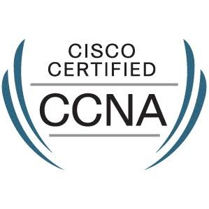
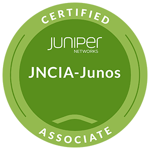
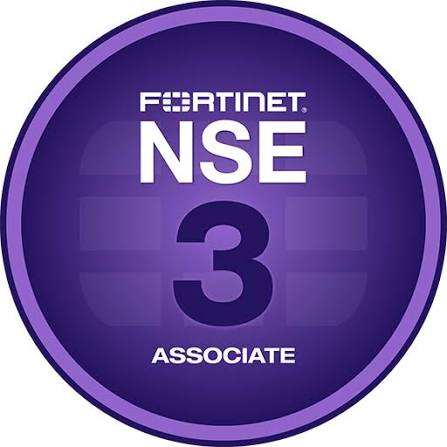
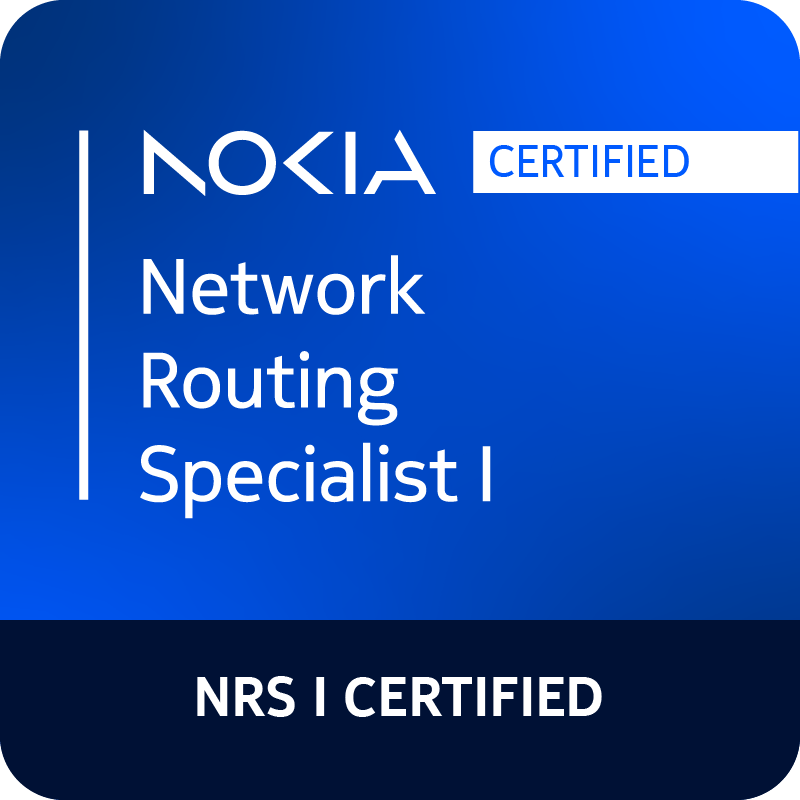

# Hi, I'm Naveen Bose

**Network & Security Engineer | Firewall Operations | Network Automation**

I’m a Network Operations Engineer with 3 years of experience supporting a large ISP environment. My work spans FortiGate firewall operations, multi-vendor routing and switching, incident and change management, and Python automation. I’m currently pursuing an MCA in Cybersecurity and building on my hands-on experience in network security and penetration testing.

## Experience highlights

- Administered FortiGate 100F/200F firewalls, including policies, NAT, security profiles, traffic inspection, and IPSec VPN tunnels.
- Completed **300+ change-management activities** and supported **10+ cluster migration projects**.
- Troubleshot Layer 2/3, firewall, and ISP connectivity issues, documenting root-cause analysis and coordinating vendor TAC escalations.
- Built Python automation with **Netmiko** and **pexpect** for multi-vendor configuration pushes, hardening, and audits across hundreds of devices.
- Monitored core, peering, and caching links with SolarWinds Orion and supported data-center installations, replacements, and migrations.

## Technical skills

- **Firewalls & security:** FortiGate, firewall policy, NAT/PAT, IPSec (IKEv1/v2), SSL VPN, security profiles, IDS/IPS, HA, VDOM, SD-WAN
- **Routing & services:** BGP, OSPF, IS-IS, MPLS, LDP, MPLS L2VPN/L3VPN, VPLS, VLAN, QinQ, LACP
- **Platforms:** Nokia SR OS, Huawei, Juniper, Cisco, Arista, FortiGate
- **Automation & tools:** Python, Netmiko, pexpect, threading, CSV/log parsing, SolarWinds Orion, Wireshark, Nmap
- **Cloud networking fundamentals:** VPC, subnets, route tables, NAT and internet gateways, peering, Transit Gateway, security groups, NACLs, Route 53
- **Security learning:** OWASP Top 10, vulnerability scanning, CVE/CVSS prioritization, Metasploit; TryHackMe Top 1% and Jr. Penetration Tester path completed

## Certifications & education

- Fortinet NSE 3
- JNCIA-Junos
- CCNA (expired February 2026)
- Fortinet NSE 4 course completed
- CCNP training
- MCA in Cybersecurity (Jain University Online) — 2026
- B.E. in Mechanical Engineering, 2017

<h3 align="center">Certifications</h3>

  
  
  
  

## Connect

- [LinkedIn](https://www.linkedin.com/in/naveen-bose-612134256)
- [Website](https://www.naveenbose.com)
- [TryHackMe- Profile](https://tryhackme.com/p/N4V33N)
